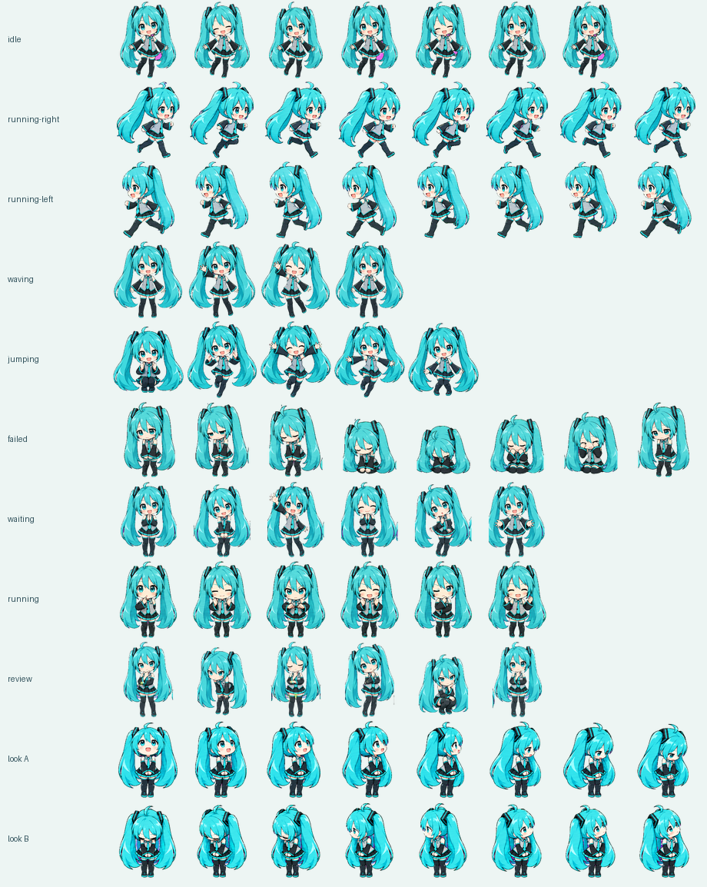
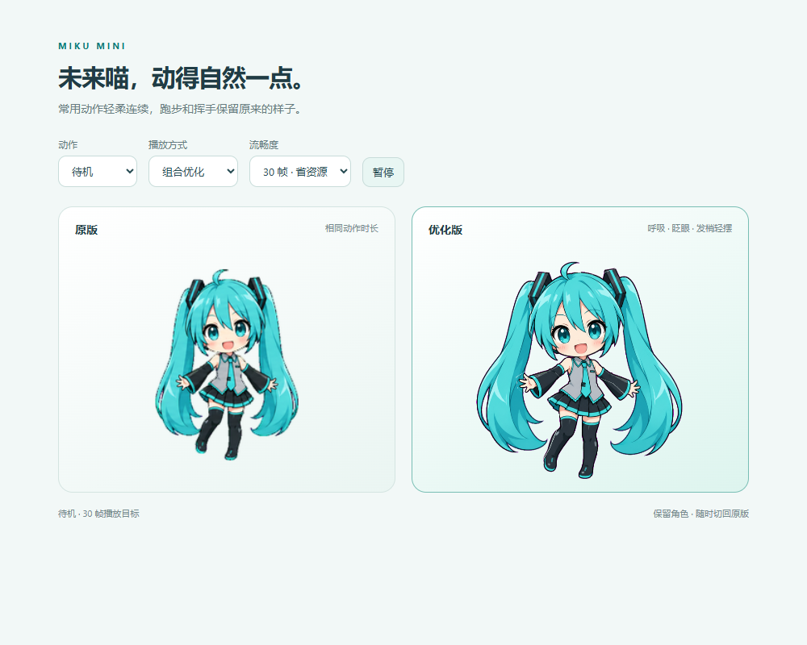
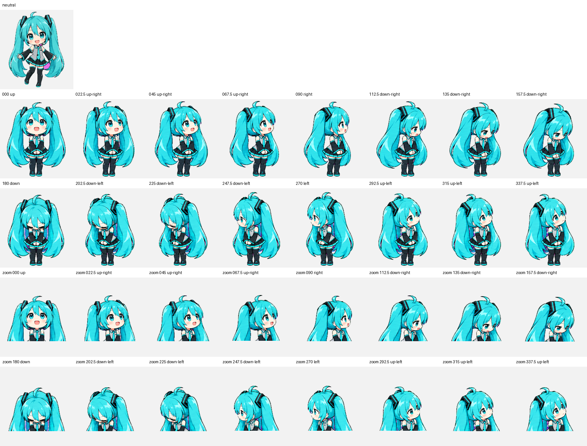

# Miku Mini · 未来喵

一个以初音未来为灵感的 Codex v2 桌面宠物。轻量优化版复用原画、开源补帧工具和分层动画运行时，让常见动作衔接更细、待机更自然。



## 优化效果




三种做法组合使用：

- **原帧校正**：少量水平位置调整（最多 2 像素），保留角色大小、跳跃高度、静态默认帧和全部 16 个注视方向。
- **精选补帧**：使用 RIFE v4.6 离线制作左右移动、挥手和跳跃的中间帧。接受的新帧分别为 7、8、4、4 张；两处有明显瑕疵的中间帧回退到原姿势。保持原动作的循环总时长和长停顿。
- **轻量分层**：待机、任务处理中、等待和审阅使用 Anime2.5DRig 的呼吸、眨眼和双马尾轻摆。模型从原画拆成六层，头部动作幅度受限，属于轻量 2.5D。

默认播放目标为 30 帧，可选 60 帧。目标值不等于实测稳定帧率；原始帧动画仍受素材数量限制。补帧模型只在制作时使用，成品播放无需下载或持续运行 AI 模型。

## 两种使用方式

| 版本 | 获得的效果 | 使用入口 |
| --- | --- | --- |
| Codex 内置兼容版 | 原帧位置微调，保持 v2 图集和 16 个注视方向 | 安装 `pet.json` 与 `assets/spritesheet.webp` |
| 独立组合桌宠 | 校正、精选补帧、连续分层动画；读取 Codex 状态 | `Start-Pet.cmd` |

完整组合效果由独立播放器提供。Codex 内置图集的固定帧布局不能容纳这个连续分层运行时。

### Windows 快速开始

需要 **64 位 Python 3.13**、Windows 和 Microsoft Edge WebView2 运行时。本机已验证该组合。Python 桌宠依赖随项目附带在 `desktop/vendor`；其他 Python 版本请在单独环境安装 `desktop/requirements.txt`。

1. 下载仓库 ZIP 并完整解压。
2. 双击 `Preview.cmd` 启动本地预览服务，再手动打开 `http://127.0.0.1:8765/`。可切换九种动作、组合/补帧/原帧模式、播放目标和暂停。
3. 双击 `Start-Pet.cmd` 打开透明桌宠窗口。窗口可拖动，底部可挥手或关闭。

桌宠每约 0.8 秒读取本机 Codex 会话记录，并给状态切换添加 220 毫秒防抖。状态读取失败时继续播放已有动作。不会自动开机启动；预览只监听本机地址。

### 安装 Codex 内置兼容版

在项目目录执行：

```powershell
py -3.13 tools/install_native.py
```

脚本先把现有 `pet.json` 和图集备份到 `outputs/native-backup-日期时间/`，再复制兼容版到 `%USERPROFILE%\.codex\pets\miku-mini`。恢复时将备份中的两个文件复制回该目录。文件替换后，应用可能需要重新加载宠物。

## 技术规格

- Codex sprite version: `2`
- Atlas: `8 × 11`
- Cell size: `192 × 208`
- Spritesheet: `1536 × 2288` RGBA WebP
- Standard animation rows: 9
- Look directions: 16 clockwise directions
- Chroma cleanup: deterministic edge-local despill

## 动作与注视

九种动作包括待机、左右移动、挥手、跳跃、失败、等待、任务处理中和审阅。Codex 兼容版保留原来的 16 个注视方向；独立桌宠使用小幅状态姿势，不跟踪全局鼠标。



## 文件

- `assets/spritesheet.webp`：可用于 Codex 的 v2 兼容图集
- `assets/source-spritesheet.webp`：完整保留的原图集
- `assets/miku-lite.psd`、`assets/layers/`：原画拆出的可编辑图层
- `pet.json`：宠物元数据
- `assets/contact-sheet.png`：11 行完整预览
- `web/`：组合播放器和预生成帧
- `desktop/`：Windows 桌宠窗口及 Codex 状态读取
- `tools/`：制作、验证和安装脚本
- `docs/`：预览、制作来源和验证记录

## 验证结果

本次验证包括：

- `1536 × 2288`、8×11、192×208 单元格验证
- `spriteVersionNumber: 2`
- 透明单元格、alpha 保留、静态默认格及 16 个方向与原版一致
- 隔离的无界面 Edge 浏览器：九种动作路由、暂停/恢复、30/60 目标、原帧备用模式和状态防抖
- 实际 pywebview / EdgeChromium 桌宠窗口：加载、九种动作路由和透明背景设置；验证后关闭
- 独立文件视觉检查：分层动画和精选插值通过；两处白色楔形瑕疵已回退修复

详细记录见 [原生图集](docs/native-validation.json)、[播放器](docs/player-validation.json)、[桌宠窗口](docs/desktop-validation.json) 和 [最终视觉 QA](docs/final-visual-qa.md)。没有进行长期稳定帧率或 CPU/GPU 占用基准测试；部分补帧仍有轻微软化，两处回退会保持原姿势更久。

旧的去色、方向和标准动作 QA 报告记录原版素材，本次变化另见 [CHANGELOG](docs/CHANGELOG.md)。

## 制作与复用

播放已带好制作结果；只有重新制作才需要 Pillow、NumPy、Node.js 和 RIFE。`tools/prepare_assets.py --base 原始角色图.png` 会从原素材重建帧与图层，`tools/write_psd.cjs` 组装 PSD，`tools/interpolate.py` 接收 RIFE 可执行文件、模型目录与动作列表。插值接受策略绑定原图哈希；更换素材需要重新检查。

复用了 [Anime2.5DRig](https://github.com/852wa/Anime2.5DRig)、[RIFE ncnn Vulkan](https://github.com/nihui/rife-ncnn-vulkan)、[pywebview](https://github.com/r0x0r/pywebview) 和 [Codex-desktop-pet](https://github.com/shicheng5589-oss/Codex-desktop-pet) 的状态读取代码。来源、版本和许可证见 [THIRD-PARTY.md](THIRD-PARTY.md)。本次未调用付费图片生成服务。

## License

Personal portfolio artwork. All rights reserved unless otherwise stated.

第三方代码分别遵循各自许可证，项目原画条款不替代第三方条款。
